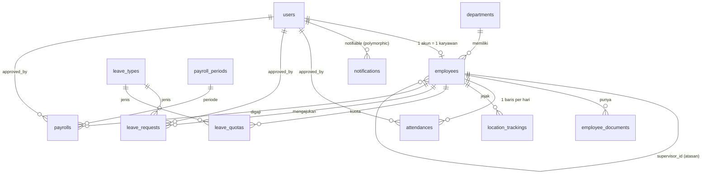

# Dokumentasi Database — Sistem Kepegawaian Berbasis Payroll PT Tinta Inspirasi Indonesia

Sumber: SDD v1.0 (bab 2) dan SRS v2.0. Skema dibangun **hanya** lewat migrasi Laravel
(`database/migrations`), sehingga pindah ke server cukup dengan `php artisan migrate`.
Diuji: SQLite (phpunit) dan MariaDB 10.11 (kompatibel MySQL) untuk `migrate:fresh`, seeding, dan rollback penuh.

## 1. Deploy ke server (tanpa setting ulang)

```bash
# 1. Buat database kosong (sekali)
mysql -u root -p -e "CREATE DATABASE payroll_tintainspirasi CHARACTER SET utf8mb4 COLLATE utf8mb4_unicode_ci;"

# 2. Isi .env server: DB_CONNECTION=mysql, DB_HOST, DB_DATABASE, DB_USERNAME, DB_PASSWORD,
#    APP_ENV=production, APP_DEBUG=false, APP_TIMEZONE=Asia/Jakarta, APP_LOCALE=id

# 3. Buat seluruh struktur + data awal wajib (jenis cuti, departemen General, akun Super Admin)
php artisan migrate --force
php artisan db:seed --class=PayrollSystemSeeder --force

# 4. Setelah login pertama: GANTI password superadmin@tintainspirasi.co.id (default ChangeMe123!)
php artisan storage:link
```

Aturan: **jangan** pernah `migrate:fresh` / `migrate:rollback` di server berisi data. Perubahan skema berikutnya
selalu dengan migrasi baru (jangan edit migrasi lama yang sudah dijalankan di server). Backup dulu: `mysqldump`.
`DashboardDemoSeeder` hanya untuk development dan menolak jalan di production.

## 2. Pemetaan SDD → implementasi

Nama tabel/kolom memakai konvensi Laravel (Inggris, jamak) agar sesuai Eloquent dan kode yang sudah ada,
bukan `tbl_*` Indonesia pada SDD. Padanannya:

| SDD | Tabel implementasi | Catatan |
|---|---|---|
| tbl_pengguna | `users` | `nama_lengkap` ada di sini (`name`); `username`, `foto_profil` (`profile_photo_path`), `status aktif/nonaktif` (`is_active`) |
| tbl_karyawan | `employees` | `gaji_pokok` = `base_salary`; `sisa_cuti` → tabel `leave_quotas`; `dokumen_ktp` → `employee_documents` |
| tbl_departemen | `departments` | |
| tbl_absensi | `attendances` | foto/koordinat masuk & keluar, `work_date`, `presence` |
| tbl_izin_cuti | `leave_requests` + `leave_types` | `jenis` → `leave_types.category` |
| tbl_penggajian | `payrolls` + `payroll_periods` | `bulan`/`tahun` → `payroll_periods` |
| tbl_tracking_lokasi | `location_trackings` | `tanggal`/`waktu` → `recorded_at`; `keterangan` → `note` |
| tbl_notifikasi | `notifications` | tabel bawaan Laravel (lihat §5) |

Tabel tambahan di luar SDD: `employee_documents`, `leave_quotas`, `payroll_periods`, `leave_types`
(normalisasi), `password_reset_tokens`, `sessions`, `cache*`, `jobs*` (infrastruktur Laravel), serta tabel
**DUMMY dashboard** `services`, `job_orders`, `announcements`, `schedules`, `schedule_attendees`, `tasks`.

## 3. ERD



## 4. Aturan data penting

| Aturan | Dijaga oleh |
|---|---|
| 5 role: `super_admin, hrd, supervisor, direktur, karyawan` (SRS v2.0) | enum `users.role` |
| Registrasi menunggu persetujuan Super Admin | `users.status` = `pending/approved/rejected` |
| Akun bisa dinonaktifkan tanpa dihapus | `users.is_active` |
| Satu absensi per karyawan per hari | `unique(employee_id, work_date)` |
| Check-in memakai `photo_path/latitude/longitude`; check-out memakai `check_out_*` | konvensi kolom |
| `attendances.status` = status persetujuan; `presence` = hadir/terlambat/alpha (snapshot saat dicatat) | dua kolom berbeda |
| Satu gaji per karyawan per periode | `unique(employee_id, payroll_period_id)` |
| Satu kuota per karyawan, jenis cuti, tahun | `unique(employee_id, leave_type_id, year)` |
| Satu NIK / username / email | unique |
| Hapus akun → data karyawan ikut terhapus; hapus approver → `approved_by` jadi NULL | FK `cascade` / `nullOnDelete` |

## 5. Keputusan desain yang berbeda dari SDD (dan alasannya)

1. **Nama Laravel, bukan `tbl_*`** — sesuai konvensi dan kode yang sudah berjalan (model, seeder, dashboard).
2. **5 role, bukan 3** — SDD v1.0 menulis `admin/hrd/karyawan`; SRS v2.0 (lebih baru) memakai 5 role. SRS yang dipakai.
3. **Status karyawan `cuti` tidak disimpan** — diturunkan dari `leave_requests` yang disetujui dan mencakup hari ini; menyimpannya berarti data yang bisa basi.
4. **`sisa_cuti` → `leave_quotas`** — kuota per jenis per tahun; sisa = `quota - used`. Satu kolom `sisa_cuti` tidak bisa menampung jenis cuti lain dan pergantian tahun.
5. **Notifikasi memakai tabel bawaan Laravel** — `$user->notify()`, `unreadNotifications`, `markAsRead()` langsung bekerja. `judul/pesan/tipe` disimpan di JSON `data`; `is_read` = `read_at IS NOT NULL`.
6. **Function/Procedure/Trigger SDD tidak dibuat di database** (`hitung_gaji_bersih`, `hitung_pph21`, `generate_penggajian`, `trg_kurangi_cuti`, `trg_notif_izin`) — SDD menulis PostgreSQL tetapi proyek berjalan di MySQL; sintaks beda antar engine, logika tersembunyi dan sulit di-test. SDD §5 sendiri menempatkannya di Service (`PayrollService`, `ApprovalService`, `NotificationService`). **Ini pekerjaan berikutnya.**
7. **View `v_karyawan_aktif`, `v_slip_gaji`, `v_rekap_absensi` dan index `idx_absensi_tgl` dibuat.** View hanya di MySQL/MariaDB/PostgreSQL (dilewati di SQLite). Di `v_rekap_absensi`, hari izin/cuti/sakit dihitung pada bulan tanggal mulainya.
8. **`payrolls.bpjs_deduction` dipertahankan sebagai total** (= `bpjs_tk_deduction` + `bpjs_kes_deduction`); diisi PayrollService.
9. **`leave_requests.total_days`** ditambahkan (tidak ada di SDD) sebagai dasar pemotongan kuota yang menggantikan trigger.
10. **`users.username` masih nullable** — login/registrasi saat ini berbasis email. Jadikan NOT NULL setelah alur auth pindah ke username (SRS use case 001/002, AC-001).

## 6. Urutan migrasi (satu migrasi per tabel, skema final)

| File | Isi |
|---|---|
| `0001_01_01_000000_create_users_table` | `users` (+ kolom SDD/SRS), `password_reset_tokens`, `sessions` |
| `0001_01_01_000001/2` | `cache*`, `jobs*` (bawaan Laravel) |
| `2025_01_01_000001`–`000003` | `departments`, `employees`, `employee_documents` |
| `000004`–`000005` | `attendances`, `location_trackings` |
| `000006`–`000008` | `leave_types`, `leave_quotas`, `leave_requests` |
| `000009`–`000010` | `payroll_periods`, `payrolls` |
| `000011` | `notifications` |
| `000012`–`000016` | tabel DUMMY dashboard: `services`, `job_orders`, `announcements`, `schedules` + `schedule_attendees`, `tasks` |
| `000017` | view `v_karyawan_aktif`, `v_slip_gaji`, `v_rekap_absensi` |

Set ini menggantikan seluruh migrasi lama (termasuk migrasi `ALTER` bertahap). Skemanya diverifikasi identik
dengan hasil migrasi lama (kolom, tipe, default, index, FK, view) sebelum yang lama dihapus.

**Database lokal lama harus dibuat ulang**: `php artisan migrate:fresh --seed --seeder=PayrollSystemSeeder`
(lalu opsional `--class=DashboardDemoSeeder`). Karena riwayat migrasi berubah, `php artisan migrate` biasa akan gagal
di database lama. Hanya aman karena belum ada data nyata/server production.

## 7. Belum tercakup (perlu keputusan)

- **"Ambil Gaji"** (SRS use case 005/018/031/044/057): karyawan mengisi form pengambilan gaji lalu disetujui atasan. Tidak ada tabelnya di SDD; kolom yang dibutuhkan belum didefinisikan.
- **Audit log** (siapa mengubah gaji/absensi) — tidak diminta SDD, tetapi lazim untuk sistem payroll.
- Penentuan tunjangan terperinci (transport, makan): SDD hanya menyimpan total `allowance`.
