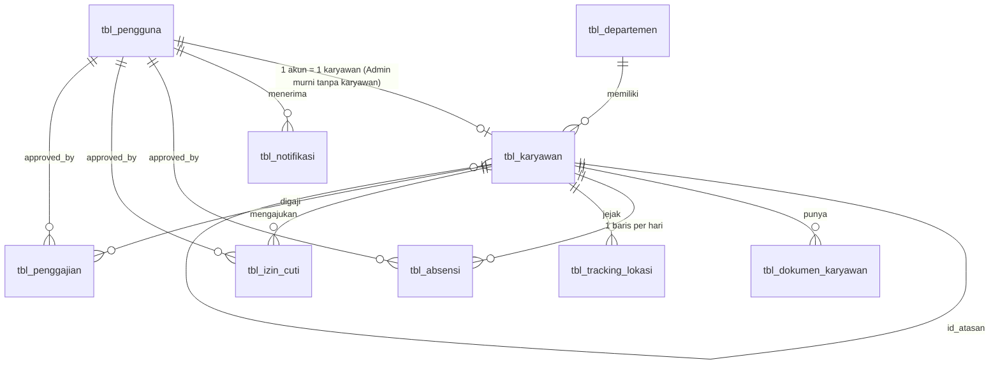

# Dokumentasi Database — Sistem Kepegawaian Berbasis Payroll PT Tinta Inspirasi Indonesia

Sumber: SDD v1.0 (bab 2) dan SRS v2.0. Nama tabel dan kolom **mengikuti SDD** (`tbl_pengguna`, `id_karyawan`,
`nama_lengkap`, dst.). Skema dibangun hanya lewat migrasi Laravel (`database/migrations`), sehingga pindah ke server
cukup dengan `php artisan migrate`. Diuji di SQLite (phpunit) dan MariaDB 10.11 (kompatibel MySQL):
`migrate:fresh`, seeding, seluruh test, dan rollback penuh.

## 1. Deploy ke server (tanpa setting ulang)

```bash
# 1. Buat database kosong (sekali)
mysql -u root -p -e "CREATE DATABASE payroll_tintainspirasi CHARACTER SET utf8mb4 COLLATE utf8mb4_unicode_ci;"

# 2. Isi .env server: DB_CONNECTION=mysql, DB_HOST, DB_DATABASE, DB_USERNAME, DB_PASSWORD,
#    APP_ENV=production, APP_DEBUG=false, APP_TIMEZONE=Asia/Jakarta, APP_LOCALE=id

# 3. Buat seluruh struktur + data awal wajib (departemen General + akun Super Admin)
php artisan migrate --force
php artisan db:seed --class=PayrollSystemSeeder --force

# 4. Setelah login pertama: GANTI password superadmin@tintainspirasi.co.id (default ChangeMe123!)
php artisan storage:link
```

Aturan: **jangan** `migrate:fresh` / `migrate:rollback` di server berisi data. Perubahan skema berikutnya selalu
dengan migrasi baru (jangan edit migrasi yang sudah dijalankan di server). Backup dulu dengan `mysqldump`.
`DashboardDemoSeeder` (data contoh karyawan, absensi, izin/cuti, penggajian, notifikasi) hanya untuk development dan menolak jalan di production.

Database lokal lama harus dibuat ulang: `php artisan migrate:fresh --seed --seeder=PayrollSystemSeeder`.

## 2. Tabel

| Tabel (SDD) | PK | Isi |
|---|---|---|
| `tbl_pengguna` | `id_pengguna` | akun login: `username`, `email`, `password`, `role`, `status` (aktif/nonaktif), `status_persetujuan`, `foto_profil` |
| `tbl_karyawan` | `id_karyawan` | data SDM: `nik`, `nama_lengkap`, `jabatan`, `gaji_pokok`, `sisa_cuti`, `status`, `dokumen_ktp`, `id_atasan` |
| `tbl_departemen` | `id_departemen` | `nama_departemen`, `deskripsi` |
| `tbl_absensi` | `id_absensi` | satu baris per karyawan per hari: `tanggal`, `jam_masuk/keluar`, `foto_*`, `lat_*`, `long_*`, `status`, `status_persetujuan` |
| `tbl_izin_cuti` | `id_izin` | `jenis` (izin/cuti/sakit), `tanggal_mulai/selesai`, `total_hari`, `alasan`, `status`, `approved_by`, `catatan_approval` |
| `tbl_penggajian` | `id_penggajian` | `bulan`, `tahun`, `gaji_pokok`, `tunjangan`, `potongan_absensi`, `pph21`, `bpjs_tk`, `bpjs_kes`, `gaji_bersih`, `status`, `tanggal_bayar` |
| `tbl_tracking_lokasi` | `id_tracking` | `tanggal`, `waktu`, `latitude`, `longitude`, `keterangan` |
| `tbl_notifikasi` | `id_notifikasi` | `judul`, `pesan`, `tipe` (izin/cuti/absensi/gaji), `is_read` |
| `tbl_dokumen_karyawan` | `id_dokumen` | dokumen digital selain KTP (SRS 3.2) |

Tabel infrastruktur Laravel (`sessions`, `cache*`, `jobs*`, `failed_jobs`, `password_reset_tokens`, `migrations`) tidak
di-rename karena dipakai langsung oleh framework.

## 3. ERD



## 4. Aturan data penting

| Aturan | Dijaga oleh |
|---|---|
| 5 role: `super_admin, hrd, supervisor, direktur, karyawan` (SRS v2.0) | enum `tbl_pengguna.role` |
| Registrasi menunggu persetujuan Super Admin; akun nonaktif tidak bisa login | `status_persetujuan` + `status`, dicek saat login |
| Satu absensi per karyawan per hari | `unique(id_karyawan, tanggal)` = `idx_absensi_tgl` |
| Satu slip gaji per karyawan per bulan | `unique(id_karyawan, bulan, tahun)` |
| Satu NIK, satu email, satu username | unique |
| Hapus akun → data karyawan ikut terhapus; hapus approver → `approved_by` jadi NULL | FK `cascade` / `nullOnDelete` |
| `tanggal` absensi tersimpan persis `Y-m-d` | model tanpa cast `date` (aman di SQLite & MySQL) |

## 5. Pemetaan SDD yang tidak harfiah (dan alasannya)

1. **Nama lengkap hanya di `tbl_karyawan`** (sesuai SDD). Akun "Admin murni" tanpa data karyawan ditampilkan memakai `username` (`User::nama_tampil`).
2. **`status` dua kolom di `tbl_pengguna`.** `status` = aktif/nonaktif (SDD). `status_persetujuan` = pending/approved/rejected (alur registrasi SRS use case 001/061). Keduanya dicek saat login.
3. **`tbl_absensi`**: `status` = hadir/terlambat/alpha (SDD); `status_persetujuan` ditambah untuk fitur Persetujuan Absensi (SRS).
4. **Status karyawan `cuti` tidak disimpan** (SDD: aktif/nonaktif/cuti). Diturunkan dari `tbl_izin_cuti` yang disetujui dan mencakup hari ini, agar tidak ada data basi.
5. **`tbl_penggajian.status`** diperluas dari `draft/approved/paid` dengan `pending_approval` dan `rejected` untuk alur persetujuan SRS. Gaji kotor tidak disimpan (= `gaji_pokok + tunjangan`).
6. **Tambahan kecil**: `tbl_izin_cuti.sub_jenis` dan `total_hari` (dasar pemotongan `sisa_cuti`, pengganti trigger), `tbl_karyawan.id_atasan`, `jenis_kelamin`, `tanggal_lahir`, `status_kepegawaian`, data rekening.
7. **Foto karyawan** = `tbl_pengguna.foto_profil` (tidak ada kolom foto kedua).
8. **Function/Procedure/Trigger SDD tidak dibuat di database** (`hitung_gaji_bersih`, `hitung_pph21`, `generate_penggajian`, `trg_kurangi_cuti`, `trg_notif_izin`): SDD menulis PostgreSQL sedangkan proyek berjalan di MySQL; sintaks beda antar engine dan sulit di-test. SDD §5 sendiri menempatkannya di Service (`PayrollService`, `ApprovalService`, `NotificationService`). Rumus gaji bersih sudah ada di `Payroll::recalculate()`.
9. **View `v_karyawan_aktif`, `v_slip_gaji`, `v_rekap_absensi`** dibuat (hanya MySQL/MariaDB/PostgreSQL; dilewati di SQLite). Hari izin/cuti/sakit pada rekap dihitung di bulan tanggal mulainya.
10. **Kunci primer** bertipe `bigint unsigned` (default Laravel), bukan `integer(10)` seperti SDD.
11. **`username` masih nullable**: login/registrasi saat ini berbasis email. Jadikan NOT NULL setelah alur auth pindah ke username (SRS use case 001/002, AC-001).
12. **Notifikasi memakai tabel SDD sendiri** (`tbl_notifikasi`), bukan tabel `notifications` bawaan Laravel, sehingga `$user->notify()` tidak dipakai; pengisian lewat `NotificationService`.

## 6. Urutan migrasi

| File | Isi |
|---|---|
| `0001_01_01_000000_create_users_table` | `tbl_pengguna`, `password_reset_tokens`, `sessions` (nama file dipertahankan agar menimpa file bawaan) |
| `0001_01_01_000001/2` | `cache*`, `jobs*` (bawaan Laravel) |
| `2025_01_01_000001`–`000003` | `tbl_departemen`, `tbl_karyawan`, `tbl_dokumen_karyawan` |
| `000004`–`000008` | `tbl_absensi`, `tbl_tracking_lokasi`, `tbl_izin_cuti`, `tbl_penggajian`, `tbl_notifikasi` |
| `000009` | view laporan (`v_karyawan_aktif`, `v_slip_gaji`, `v_rekap_absensi`) |

Database hanya berisi tabel SDD (+ `tbl_dokumen_karyawan` dari SRS). Tidak ada tabel dummy.

## 7. Belum tercakup (perlu keputusan)

- **"Ambil Gaji"** (SRS use case 005/018/031/044/057): karyawan mengisi form pengambilan gaji lalu disetujui atasan. Tidak ada tabelnya di SDD; kolom yang dibutuhkan belum didefinisikan.
- **Audit log** (siapa mengubah gaji/absensi): tidak diminta SDD, tetapi lazim untuk sistem payroll.
- **Login dengan username** (AC-001): sekarang email saja.

## 8. Asal data tiap bagian dashboard

| Bagian dashboard | Sumber data |
|---|---|
| Total karyawan, Total divisi | `tbl_karyawan`, `tbl_departemen` |
| Hadir hari ini, ringkasan On-Time/Late/Absent/On Leave, tabel Attendance | `tbl_absensi` + `tbl_izin_cuti` (jam masuk dibandingkan dengan `config/attendance.php`) |
| Pending approval | `tbl_izin_cuti` + `tbl_absensi` + `tbl_penggajian` berstatus menunggu |
| Tab Notification (search + filter jenis) | `tbl_notifikasi` milik user yang login |
| Tab Submission | `tbl_izin_cuti` berstatus `pending` |
| Tab Approval | `tbl_absensi` `pending` dan `tbl_penggajian` `pending_approval` |
| Leave Schedule (All/Cuti/Izin/Sakit) | `tbl_izin_cuti` berstatus `approved` yang belum berakhir |

Komponen prototype yang tidak punya dasar di SDD (Total service, Total job, Announcement, Task, Schedule meeting) diganti dengan data di atas.
